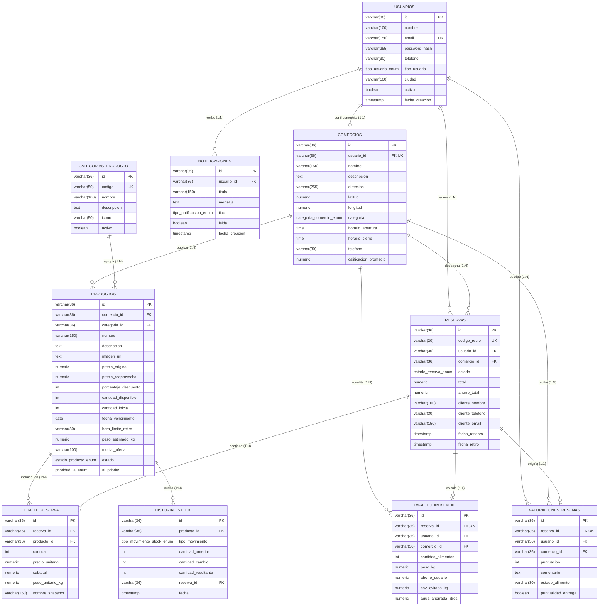

# Diagrama Entidad-Relación Extendido (DERE) - Plataforma ReAprovecha Tandil

Este documento describe el modelo conceptual, lógico y físico de datos para la plataforma **ReAprovecha Tandil**, diseñada para el rescate y comercialización con descuento de excedentes alimentarios y productos próximos a vencer.

---

## 1. Modelo Conceptual y Semántica del DERE

### 1.1 Entidades Principales

1. **`USUARIOS` (Superentidad)**:
   - Contiene los atributos comunes a todas las personas u organizaciones que acceden al sistema: identidad, credenciales seguras, datos de contacto y rol.
   - **Especialización Total y Disjunta**:
     - `Consumidor`: Usuario final que busca ofertas, reserva alimentos y retira en tienda.
     - `Comercio`: Proveedor o elaborador que publica sus lotes de excedente.
     - `Administrador`: Rol de gestión, soporte y validación de calidad.

2. **`COMERCIOS` (Entidad Especializada / Fuerte)**:
   - Representa el establecimiento físico radicado en Tandil.
   - Relación 1:1 obligatoria con `USUARIOS` (un comercio siempre está respaldado por una cuenta de usuario).
   - Posee coordenadas geográficas (`latitud`, `longitud`) para permitir el cálculo de cercanía por fórmula de Haversine hacia el consumidor.

3. **`CATEGORIAS_PRODUCTO` (Entidad de Clasificación)**:
   - Catálogo estandarizado de rubros: Lácteos, Panadería, Carnes y Embutidos, Frutas y Verduras, Almacén y Pastas, Bebidas, etc.

4. **`PRODUCTOS` (Entidad Fuerte)**:
   - Representa el lote o producto publicado para rescate.
   - Cada producto pertenece obligatoriamente a un comercio (`comercio_id`) y a una categoría (`categoria_id`).
   - Almacena precios (`precio_original`, `precio_reaprovecha`), fecha de vencimiento, motivo de la oferta (vencimiento, exceso de stock, defecto estético inocuo) e indicadores de urgencia calculados por IA.

5. **`RESERVAS` (Entidad Transaccional)**:
   - Instancia de compra y reserva presencial formalizada por un consumidor ante un comercio.
   - Dispone de un `codigo_retiro` amigable (ej. `REP-5921`) para verificación rápida en mostrador.
   - Ciclo de estados: `pendiente` → `confirmada` → `lista_para_retirar` → `retirada` (o `cancelada`).

6. **`DETALLE_RESERVA` (Entidad Débil por Existencia e Identificación)**:
   - Líneas de pedido que asocian `RESERVAS` con `PRODUCTOS`.
   - Congela el precio unitario pactado al momento de la reserva (*snapshot* de precio y peso) para preservar el historial contable aun si el producto cambia de precio posteriormente.

7. **`IMPACTO_AMBIENTAL` (Entidad Histórica y Analítica)**:
   - Registra el ahorro social y ecológico generado por cada reserva concretada.
   - Métricas: `peso_kg` rescatado, `co2_evitado_kg` (basado en estándar FAO: 2.5 kg CO₂e / kg de alimento), `agua_ahorrada_litros` y `ahorro_usuario` en pesos argentinos.

8. **`VALORACIONES_RESENAS` (Entidad de Reputación)**:
   - Calificación de 1 a 5 estrellas, evaluación del estado físico del producto y puntualidad de entrega en el comercio.

9. **`HISTORIAL_STOCK` (Entidad de Auditoría)**:
   - Bitácora inmutable de movimientos de stock: creación de oferta, reserva, cancelación y reposición, ajuste manual o baja por vencimiento.

10. **`NOTIFICACIONES` (Entidad de Comunicación)**:
    - Alertas de confirmación de reserva, recordatorio de horario límite de retiro y notificaciones de productos próximos a expirar.

---

## 2. Diagrama de Relaciones y Cardinalidades

```
+----------------+          1 : 1          +----------------+
|    USUARIOS    |------------------------->|   COMERCIOS    |
+----------------+                          +----------------+
        |                                           |
        | 1                                         | 1
        |                                           |
        | N                                         | N
        v                                           v
+----------------+          1 : N           +----------------+
|    RESERVAS    |<-------------------------|   PRODUCTOS    |
+----------------+                          +----------------+
        |                                           ^
        | 1                                         |
        |                                           | 1
        | N                                         |
        v                                           | N
+----------------+          N : 1                   |
| DETALLE_RESERVA|----------------------------------+
+----------------+
        |
        | 1 : 1
        v
+--------------------+      +--------------------+      +--------------------+
| IMPACTO_AMBIENTAL  |      |VALORACIONES_RESENAS|      |  HISTORIAL_STOCK   |
+--------------------+      +--------------------+      +--------------------+
```

### Tabla de Cardinalidades y Reglas de Negocio

| Entidad Origen | Relación | Entidad Destino | Cardinalidad | Participación | Regla de Negocio / Integridad |
| :--- | :--- | :--- | :---: | :---: | :--- |
| **USUARIOS** | Posee | **COMERCIOS** | 1 : 1 | Parcial en Usuario / Total en Comercio | Un usuario puede ser comercio o consumidor. Todo comercio requiere un usuario creador. Si se borra el usuario, se elimina el comercio (`CASCADE`). |
| **COMERCIOS** | Publica | **PRODUCTOS** | 1 : N | Total en Producto | Un comercio puede publicar múltiples productos. Todo producto debe pertenecer a un comercio. Si se borra el comercio, se eliminan sus productos (`CASCADE`). |
| **CATEGORIAS** | Clasifica | **PRODUCTOS** | 1 : N | Total en Producto | Cada producto pertenece a una categoría. No se puede borrar una categoría en uso (`RESTRICT`). |
| **USUARIOS** | Emite | **RESERVAS** | 1 : N | Parcial en Usuario | Un consumidor puede emitir 0 a N reservas. Una reserva pertenece a exactamente 1 usuario. No se puede borrar un usuario con reservas (`RESTRICT`). |
| **COMERCIOS** | Recibe | **RESERVAS** | 1 : N | Total en Comercio | Un comercio recibe 0 a N reservas de clientes. |
| **RESERVAS** | Desglosa | **DETALLE_RESERVA** | 1 : N | Total en Detalle | Toda reserva debe tener al menos 1 ítem de detalle. Si se elimina la reserva, se eliminan sus detalles (`CASCADE`). |
| **PRODUCTOS** | Figura en | **DETALLE_RESERVA** | 1 : N | Parcial en Producto | Un producto puede estar en múltiples detalles. No se puede borrar físicamente un producto con ventas activas (`RESTRICT`). |
| **RESERVAS** | Genera | **IMPACTO_AMBIENTAL** | 1 : 1 | Parcial en Reserva | Cada reserva confirmada o retirada genera exactamente 1 registro auditable de impacto ambiental. |
| **RESERVAS** | Recibe | **VALORACIONES** | 1 : 0..1 | Parcial en Reserva | Una reserva completada puede recibir como máximo 1 reseña por parte del cliente que retiró. |
| **PRODUCTOS** | Registra | **HISTORIAL_STOCK** | 1 : N | Total en Historial | Cada movimiento de unidades en un producto queda registrado para auditoría y trazabilidad. |
| **USUARIOS** | Recibe | **NOTIFICACIONES** | 1 : N | Total en Notificación | Mensajes dirigidos a consumidores y comercios. Si se borra el usuario se borran sus notificaciones (`CASCADE`). |

---

## 3. Diagrama Mermaid (DERE)



---

## 4. Diccionario de Datos y Normalización (3FN)

El diseño cumple estrictamente con la **Tercera Forma Normal (3FN)**:
1. **1FN**: Todos los atributos son atómicos (sin listas repetitivas dentro de celdas; los ítems de reserva se desacoplan en `detalle_reserva`).
2. **2FN**: Toda columna no clave depende por completo de la clave primaria completa.
3. **3FN**: No existen dependencias transitivas (ej. los datos del comercio no se duplican en la tabla `productos`, solo se almacena `comercio_id`; los datos del cliente no se duplican en `impacto_ambiental`, solo se vinculan mediante claves foráneas).
